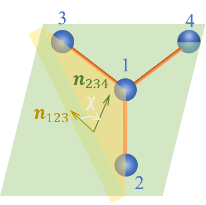

# Improper potentials

An improper torsion type is defined by a quadruplet of atom types, a functional form and the corresponding parameters values.
The first atom type of the quadruplet is the central atom. The three other types can be given in any order: a set of parameters
applies to every improper torsion whose central atom and three neighbors have these types.
So far in **exaStamp**, improper torsion angles have only been used to maintain the central atom in the plane defined by the three other atoms.

An improper torsion angle is computed for every atom that has exactly three bonded neighbors. Atom 1 of the figure is the central atom,
and atoms 2, 3 and 4 are its neighbors **in the order of the connectivity given in the input file**.
The value of the angle depends on which neighbor comes last (atom 4), so this order is part of the input.

<figure markdown="span">
  { width="400" }
  <figcaption>An improper torsion angle between atoms 1, 2, 3 and 4.  </figcaption>
</figure>

The expression of the improper torsion angle $\chi$ is the exact same as that of the "proper" torsion angle, with
atoms 1, 2, 3 and 4 in the order specified above.
It is useful to define first the vectors $\mathbf{V}$ and $\mathbf{W}$:

$$
\mathbf{V} = \frac{\mathbf{r}_{21}\times \mathbf{r}_{23}}{\lVert \mathbf{r}_{21} \lVert \lVert \mathbf{r}_{23} \lVert}
$$

$$
\mathbf{W} = \frac{\mathbf{r}_{34}\times \mathbf{r}_{23}}{\lVert \mathbf{r}_{34} \lVert \lVert \mathbf{r}_{23} \lVert}.
$$

The improper torsion angle $\chi$ is then given by its cosine and sign:

$$
\cos{\chi} = \mathbf{V}\cdot\mathbf{W}
$$

$$
\text{sgn }\chi = \text{sgn} \left ( \mathbf{V}\times\mathbf{W}\cdot\mathbf{r}_{23} \right )
$$

The following types of improper torsion potentials are defined in **exastamp**:

- [**harm_improper**](harm_improper.md)
- [**opls_improper**](opls_improper.md)
- [**no_potential**](no_potential.md)

